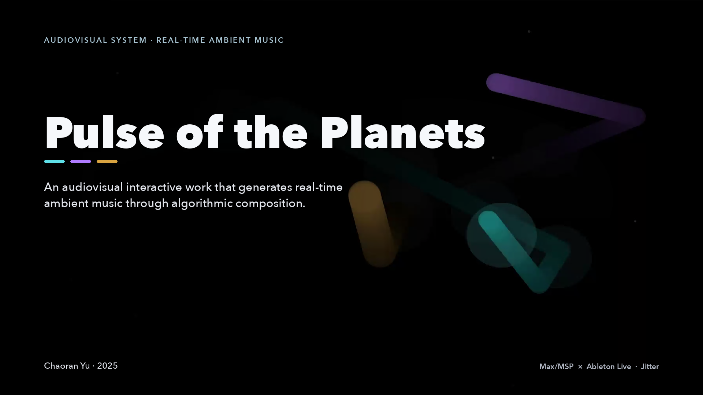
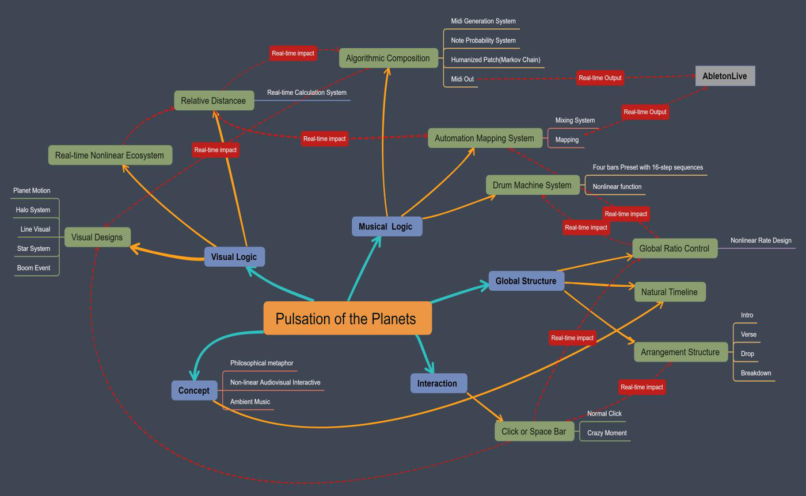
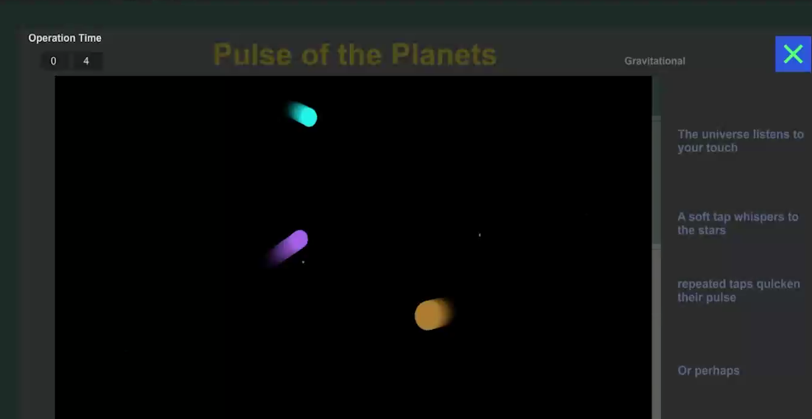

**English** · [简体中文](README.zh-CN.md)

[](docs/visuals/interface.png)

**An Audiovisual Interactive Work for Real-Time Ambient Music**

Three orbiting bodies feed their distances into a Max/MSP patch that decides when a note
sounds, how stable its pitch is, how bright it is and where it sits in the stereo field.
Max sends the result as MIDI to Ableton Live.

[**Watch the demo ↗**](https://drive.google.com/file/d/1_hQ9HYrGGCtSpjZboQTFH4UmxnuTzK3l/view?usp=sharing) · [**Listen ↗**](https://drive.google.com/file/d/1ZjxpxV6FQ7RqstGci5RBT5kc5v-hplh5/view?usp=sharing) · [**Read the report**](REPORT.pdf) · [**Run it**](#run-it)

Chaoran Yu · 2025

<details>
<summary>Demonstration and recordings</summary>

Long media is hosted on Google Drive rather than stored in the repository.

| Material | File | Link |
|---|---|---|
| Demonstration performance (about 11 minutes) | `Pulse_of_the_Planets.mp4` | [Watch on Google Drive](https://drive.google.com/file/d/1_hQ9HYrGGCtSpjZboQTFH4UmxnuTzK3l/view?usp=sharing) |
| Recorded run (7 min 24 s, 44.1 kHz stereo) | `Pulse_of_the_Planets_runAudio.wav` | [Listen on Google Drive](https://drive.google.com/file/d/1ZjxpxV6FQ7RqstGci5RBT5kc5v-hplh5/view?usp=sharing) |

Both links are set to *anyone with the link can view*.

</details>

## What I built

- Three bodies that drift toward randomly chosen targets, so their positions and pairwise
  distances become the musical data for the whole piece.
- A note-probability system plus a second, modal-stability layer that quantises pitch through
  itables — a Dorian mode with octave offsets for two synth layers and a bass.
- MIDI out to Ableton Live, where distance drives filter brightness, level and stereo
  placement, alongside a `matrixctrl` drum machine and a form that moves through intro,
  verse and drop.

## How it works

The piece starts from Newton's law of universal gravitation and Kepler's laws of planetary
motion: the closer a body is to what it orbits, the faster it moves. *Pulse of the Planets*
turns that relationship into a performance — distance controls how often a note sounds and
how stable it is, position controls the mix, and the listener's hand on the space bar
determines when the music opens up.

**Three bodies, three pulse rates.** A (blue) responds on quarter notes, B (purple) on half
notes and C (gold) on whole notes. Each one moves toward a randomly chosen point and can pick
a new target while it travels, so the motion stays smooth and non-linear. A global control
ratio scales the whole system, and the main metre, drum machine, automation and visuals all
read that one value.

**From distance to a note.** Each frame the patch measures the three centre-to-centre
distances with the Pythagorean theorem, clips them to a working range, shapes the result with
a power curve and maps it to a trigger probability, compared against `random 1000`. Close
bodies also unlock a repeated-note behaviour; far-apart bodies thin the texture out.

**From distance to pitch.** Notes are picked from a Dorian-mode `coll` by index. A second
probabilistic layer handles modal stability: the closer the bodies are, the more likely an
unstable degree is pulled toward a stable one. Those probabilities are mapped to itables, so
quantisation can shift continuously rather than in steps. A root offset moves the same scale
into different registers for the two synth layers and the bass.

**Humanised MIDI.** Before `noteout`, velocity passes through a small Markov chain built with
`anal` and `prob`; the report notes that pitch learning did not suit the piece, so the process
is applied to velocity only.

**Automation in Ableton Live.** As a body approaches the centre of the screen, a shelving
filter releases its high-frequency attenuation and the timbre brightens. The overall level
rises as the bodies move closer together, and each body's horizontal position becomes its
panorama position. The report's screenshot of the Live MIDI assignments documents the filter,
volume and pan sends.

**Drum machine and form.** A four-bar, 16-step `matrixctrl` sequence with `preset` storage
starts up once the global ratio crosses a threshold, and a counter's first outlet switches
between three playback modes to keep the drum loop non-linear. After the start, the gold
body's note triggers drive the transition: the first three successful triggers accelerate
the ratio multiplicatively, then the piece settles into the verse, where the rate keeps
changing at random intervals inside a fixed speed range.

**Interaction.** Clicking the button or pressing the space bar pulls the global ratio down
linearly, which speeds up the whole system. After a click the ratio starts to rebound, but
clicks within 0.8 seconds delay the rebound until the clicking stops. Fifteen presses within
four seconds triggers *Crazy Moment*, a chain reaction that multiplies the global parameters
and throws the piece into a chaotic peak. Either way, an interaction forces the drop: a stable
BPM, the non-linear drum pattern and a burst of flickering starlight. When the piece returns
to the verse and the listener stops interacting, the rate decays again — the breakdown of the
universe, as the report puts it: everything rises, peaks and fades.

**Visuals.** Everything is drawn with `jit.lcd` on a 1920×1080 canvas. A halo fires on every
note event, with a randomised radius derived from the Pythagorean theorem; halos double as
collision detectors. When two bodies touch, a ray is drawn between them; when all three halos
fire within the same beat, a full-screen flash runs (*Boom*) and luminous lines bind the
three bodies together. The star system generates 200 points per state, stored in `coll`
tables and repainted as the form advances.

## System architecture

<details>
<summary>View the system architecture and the Max patch</summary>



One Max/MSP patch runs the movement, the distance maths, the note and pitch probabilities,
the automation, the drum machine, the arrangement and the Jitter visuals. Ableton Live is
the sound source and the mixer: Max sends notes and continuous controllers over virtual MIDI,
and Live's mapping turns those controllers into filter, level and pan automation.



The presentation view: the operation-time counter, the three planets, the poetic instruction
column and the *Click or Space* trigger.

</details>

## Run it

1. Install **Max 9** (the patch was saved with 9.0.8) including **Jitter**, and
   **Ableton Live** for the instruments and the mix.
2. On Windows, install **loopMIDI** and create the virtual ports the patch addresses:
   `loopMIDI Port 1` through `loopMIDI Port 7`. The patch is built around these names; on
   macOS you need to rename them or add matching virtual ports (see the
   [setup guide](docs/setup-guide.md#3-virtual-midi)).
3. Build the Live set — two pitched tracks, a bass track and a drum rack on the incoming MIDI
   channels, with the filter, volume and pan controllers mapped as described in the report.
   The author's Live set is not distributed, so this is the step you supply.
4. Open `patch/Pulse_of_the_Planets.maxpat`. The patch starts itself from a `loadbang`,
   opens its Jitter window and begins sending MIDI.
5. Confirm that Live receives notes and that the three planets move inside their frame.
6. Press the space bar or click **Click or Space** to interact, and watch the verse move
   toward the drop.

The full operating manual — port setup, Live track configuration, interface reference,
interaction timing and troubleshooting — is in [`docs/setup-guide.md`](docs/setup-guide.md).
A fresh installation can be checked with the [verification checklist](docs/verification.md).

## Requirements

Developed on Windows; the demo recording shows a Windows desktop and the patch addresses
`loopMIDI` virtual ports. The saved patch records Max 9.0.8, x64. Author hardware and the
Ableton Live version were not recorded in the project files — see
[environment notes](docs/environment.md).

- **Max 9.0.8 or later**, with Jitter (the visuals use `jit.lcd`, `jit.window` and
  `jit.pwindow`)
- **Ableton Live**, with an instrument set for the two synth layers, the bass and the drums
- **loopMIDI** (Windows) or an equivalent virtual MIDI port arrangement
- A display that can show the 1920×1080 Jitter window, and an audio output for Live

## The written report

[](REPORT.pdf)

[**Pulse of the Planets — project report (PDF, 20 pages)**](REPORT.pdf)

The report is the main written document: the planetary-motion motivation, the movement and
distance system, the note-probability and MIDI-generation systems, the humanised patch, the
Ableton automation mapping, the drum machine and arrangement, the interaction design and the
visual systems, with patch screenshots throughout.

## Repository layout

<details>
<summary>View the repository tree</summary>

```
README.md                     This page
README.zh-CN.md               Simplified Chinese version
REPORT.pdf                    Written project report (20 pages)
NOTICE.md                     Copyright and terms of use
llms.txt                      Machine-readable index for AI tools
docs/
    environment.md            Recorded environment and reproduction limits
    verification.md           Static checks and what they do not prove
    release-notes.md          Initial public release notes
    setup-guide.md            Operating manual: MIDI, Live set, interface, interaction
    ai-assistant-guide.md     Setup guide written for AI assistants
    visuals/                  Cover and presentation-mode screenshot
    architecture/             Patch diagrams from the report
patch/
    Pulse_of_the_Planets.maxpat   Main Max patch (single file, no abstractions)
```

The patch is self-contained: it loads no abstractions, samples or external files, so the
single `.maxpat` file can be opened from anywhere.

</details>

## What is not included

- **The Ableton Live set.** The instruments, racks and the MIDI mapping lived in the author's
  Live set and were not part of the exported project files. The patch sends standard notes and
  continuous controllers; the report documents the mapping, and the
  [setup guide](docs/setup-guide.md#4-the-ableton-live-set) lists what to rebuild.
- **Videos and audio examples** — linked from Google Drive above.

## Set up with an AI assistant

To have an AI assistant walk you (or itself) through the installation, paste this line into it:

```
Read https://raw.githubusercontent.com/Chora666/pulse-of-the-planets/main/docs/ai-assistant-guide.md and help me get Pulse of the Planets running.
```

That file is a setup guide written for AI assistants: what to install, how to create the MIDI
ports, what to rebuild in Live, how to check the result, and where the setup usually breaks.
[`llms.txt`](llms.txt) carries the same pointers in the llms.txt format.

## Credits

The work was developed for a sound-design programme, and the report thanks the Sound Design
teaching team for guidance and inspiration. Max/MSP and Jitter are by Cycling '74; Ableton
Live is by Ableton. The patch uses only objects that ship with Max; the report's Live-session
screenshots show a FabFilter Pro-Q 4 equaliser and a dearVR MICRO spatialiser in the author's
set.

## Licensing

- **The Max/MSP patch** — [PolyForm Noncommercial 1.0.0](LICENSE.md). Free for any
  noncommercial purpose: study, teaching, research, personal and noncommercial artistic work.
  **Commercial use requires a separate licence** — contact the author (see below).
- **Documentation and report** — [CC BY-NC 4.0](https://creativecommons.org/licenses/by-nc/4.0/).
  Share and adapt with attribution, non-commercial use only.

Music made with the system is your own work, not a derivative of the patch, so these licences
say nothing about your recordings.

For a commercial licence, open an issue at
[the issue tracker](https://github.com/Chora666/pulse-of-the-planets/issues) or message
[@Chora666](https://github.com/Chora666). Citation format and the credit line are in
[NOTICE.md](NOTICE.md). Third-party material keeps its own licences and is not relicensed here.
