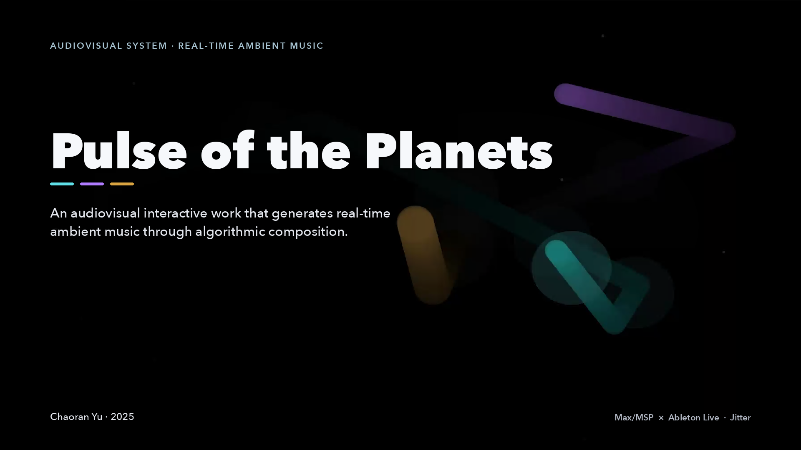
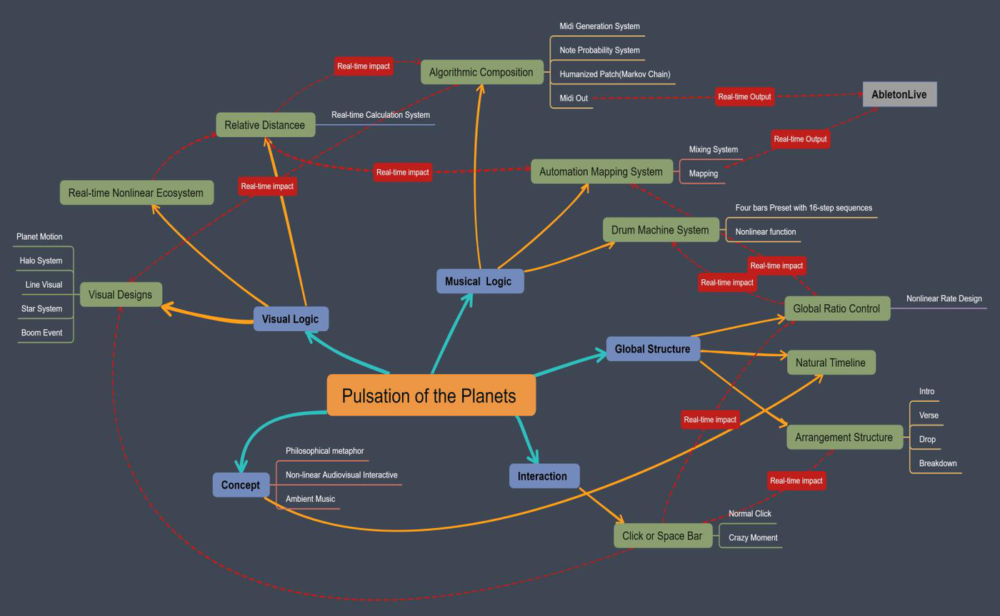
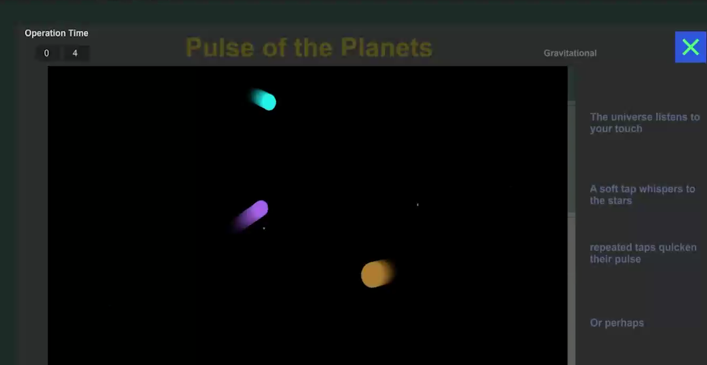

[English](README.md) · **简体中文**

[](docs/visuals/interface.png)

**一个生成实时氛围音乐的视听互动作品**

三个运行中的天体把彼此的距离送入 Max/MSP patch，由它决定何时发声、音高有多稳定、
音色有多明亮、以及在立体声场中的位置。Max 把结果以 MIDI 送往 Ableton Live。

[**观看演示 ↗**](https://drive.google.com/file/d/1_hQ9HYrGGCtSpjZboQTFH4UmxnuTzK3l/view?usp=sharing) · [**试听 ↗**](https://drive.google.com/file/d/1ZjxpxV6FQ7RqstGci5RBT5kc5v-hplh5/view?usp=sharing) · [**阅读报告**](REPORT.pdf) · [**运行指南**](#运行)

俞超然（Chaoran Yu）· 2025

<details>
<summary>演示与录音</summary>

较长的媒体文件托管在 Google Drive，不存放在仓库中。

| 内容 | 文件 | 链接 |
|---|---|---|
| 完整演示演出（约 11 分钟） | `Pulse_of_the_Planets.mp4` | [在 Google Drive 观看](https://drive.google.com/file/d/1_hQ9HYrGGCtSpjZboQTFH4UmxnuTzK3l/view?usp=sharing) |
| 录音版本（7 分 24 秒，44.1 kHz 立体声） | `Pulse_of_the_Planets_runAudio.wav` | [在 Google Drive 收听](https://drive.google.com/file/d/1ZjxpxV6FQ7RqstGci5RBT5kc5v-hplh5/view?usp=sharing) |

两个链接均设置为「知道链接的人均可查看」。

</details>

## 我实现的内容

- 三个不断飘向随机目标点的天体，它们的位置与两两距离就是整首曲子的音乐数据。
- 一套音符概率系统，外加一层调式稳定性判断，通过 itable 对音高做实时量化——Dorian
  调式，并用八度偏移分出两个合成器层与一条贝斯。
- 把 MIDI 送往 Ableton Live：距离控制滤波亮度、音量与声像，另有 `matrixctrl` 鼓机，
  以及由 intro、verse、drop 组成的曲式。

## 工作原理

作品从牛顿万有引力定律与开普勒行星运动定律出发：天体离中心越近，运行越快。
*Pulse of the Planets* 把这个关系变成一场演奏——距离决定音符出现的频率与音高的稳定程度，
位置决定混音，而听众按下空格键的时机决定音乐何时张开。

**三个天体，三种脉冲。** A（蓝色）在四分音符上响应，B（紫色）在二分音符上响应，
C（金色）在全音符上响应。每个天体朝一个随机目标点移动，途中可以随时改换目标，运动因此
平滑而非线性。一个全局控制比例缩放整个系统，主拍、鼓机、自动化与视觉都读取这一个值。

**从距离到音符。** patch 每一帧用勾股定理算出三个中心点之间的距离，把结果裁进工作范围，
用幂曲线塑形，再映射成触发概率，与 `random 1000` 比较。天体靠近时还会解锁同音连续触发；
天体远离时织体自然变薄。

**从距离到音高。** 音符通过索引从 Dorian 调式的 `coll` 中取出。第二层概率处理调式稳定性：
天体越近，不稳定音越容易被拉向稳定音。这些概率被连续映射到 itable，因此量化不是跳变的台阶，
而是连续漂移。一个根音偏移把同一音阶移到不同音区，分别给两个合成器层和贝斯。

**人性化 MIDI。** 在进入 `noteout` 之前，力度会经过一个由 `anal` 与 `prob` 搭成的小型
马尔可夫链。报告里说明音高学习并不适合这首作品，因此马尔可夫过程只作用于力度。

**Ableton Live 中的自动化。** 天体越靠近屏幕中心，一个 shelving 滤波器就越放开高频衰减，
音色随之变亮；三个天体整体越靠近，总音量越大；每个天体的横向位置则成为它的声像位置。
报告里的映射表（以及 Live MIDI 映射的截图）记录了滤波、音量与声像这三组发送。

**鼓机与曲式。** 一个四小节、16 步的 `matrixctrl` 序列配合 `preset` 存储，在全局比例越过
阈值后启动；counter 的第一个出口在三种播放模式间随机切换，让鼓组循环保持非线性。启动后，
金色天体的音符触发推动结构：前三次成功触发以乘性方式加速比例，之后进入 verse，比例继续以
随机间隔变化，但被限制在一个固定的速度范围内。

**互动。** 点击按钮或按空格键会让全局比例线性下降，整个系统随之加速。松手后比例开始回弹，
但 0.8 秒内继续点击会借助 `del` 机制延迟回弹，直到点击停下。四秒内按满 15 次会触发
*Crazy Moment*：全局参数被乘性放大，作品被推向混乱的顶点。无论是否触发，互动都会把作品推进
drop：稳定的 BPM、非线性的鼓组与满屏闪烁的星光。回到 verse 后若不再互动，比例会逐渐回落——
正如报告所说，一切升起、抵达顶点，然后消散。

**视觉。** 全部画面由 `jit.lcd` 在 1920×1080 的画布上绘制。每次音符事件都会点亮一个光晕，
半径由勾股定理随机得出；光晕同时充当碰撞检测。两个天体相触时画出一道光线；三个光晕在同一拍
内全部触发时，全屏闪光（*Boom*），并有用光线把三个天体连在一起。星空系统为每个状态生成
200 个点，存进 `coll`，随曲式推进重绘。

## 系统架构

<details>
<summary>展开系统架构与 Max patch</summary>



一个 Max/MSP patch 负责运动、距离计算、音符与音高概率、自动化、鼓机、曲式以及 Jitter 视觉。
Ableton Live 是音源与混音台：Max 通过虚拟 MIDI 发送音符与连续控制器，Live 的映射把这些
控制器变成滤波、音量与声像的自动化。



演示界面：运行时长计数、三个天体、右侧的提示文字，以及 *Click or Space* 触发按钮。

</details>

## 运行

1. 安装 **Max 9**（patch 保存于 9.0.8）并包含 **Jitter**，以及用于音源与混音的
   **Ableton Live**。
2. 在 Windows 上安装 **loopMIDI**，创建 patch 所使用的虚拟端口：
   `loopMIDI Port 1` 至 `loopMIDI Port 7`。patch 围绕这些端口名构建；在 macOS 上需要改名
   或建立同名的虚拟端口（见[操作手册](docs/setup-guide.md#3-虚拟-midi)）。
3. 搭建 Live 工程——两条有音高的轨道、一条贝斯轨和一套鼓组，分别接收对应的 MIDI 通道，
   并按报告所述映射滤波、音量与声像控制器。作者的 Live 工程没有随仓库发布，这一步需要你
   自己补齐。
4. 打开 `patch/Pulse_of_the_Planets.maxpat`。patch 会通过 `loadbang` 自行启动，打开 Jitter
   窗口并开始发送 MIDI。
5. 确认 Live 收到音符，三个天体在画框内运动。
6. 按空格键或点击 **Click or Space** 进行互动，看 verse 如何走向 drop。

完整操作手册——端口设置、Live 轨道配置、界面说明、互动时序与排错——见
[`docs/setup-guide.md`](docs/setup-guide.md)。新环境可按[人工验收清单](docs/verification.md)
逐项检查。

## 环境要求

项目在 Windows 上开发；演示录像显示的是 Windows 桌面，patch 使用 `loopMIDI` 虚拟端口。
保存的 patch 记录为 Max 9.0.8、x64。作者的硬件与 Ableton Live 版本未记录在工程文件中——
详见[环境说明](docs/environment.md)。

- **Max 9.0.8 或更高版本**，含 Jitter（视觉使用 `jit.lcd`、`jit.window` 与 `jit.pwindow`）
- **Ableton Live**，以及两个合成器层、贝斯与鼓组的音源设置
- **loopMIDI**（Windows）或同等的虚拟 MIDI 端口方案
- 能显示 1920×1080 Jitter 窗口的显示器，以及供 Live 使用的音频输出

## 项目报告

[](REPORT.pdf)

[**Pulse of the Planets —— 项目报告（PDF，20 页）**](REPORT.pdf)

报告是主要的文字成果：行星运动的动机、运动与距离系统、音符概率与 MIDI 生成系统、
人性化处理、Ableton 自动化映射、鼓机与编曲、互动设计以及视觉系统，并配有大量 patch 截图。

## 仓库结构

<details>
<summary>展开目录树</summary>

```
README.md                     本页
README.zh-CN.md               简体中文版
REPORT.pdf                    项目报告全文（20 页）
NOTICE.md                     版权与使用条款
llms.txt                      给 AI 工具用的机器可读索引
docs/
    environment.md            记录的环境与复现限制
    verification.md           静态检查及其不能证明的部分
    release-notes.md          首次公开发布说明
    setup-guide.md            操作手册：MIDI、Live 工程、界面、互动
    ai-assistant-guide.md     写给 AI 助手的安装说明
    visuals/                  封面与演示模式截图
    architecture/             报告中的 patch 图示
patch/
    Pulse_of_the_Planets.maxpat   Max 主 patch（单文件，无抽象）
```

patch 是自包含的：不加载任何抽象、样本或外部文件，因此这个 `.maxpat` 单文件可以在任何位置
直接打开。

</details>

## 未包含的内容

- **Ableton Live 工程。** 音源、效果机架与 MIDI 映射都在作者的 Live 工程里，没有随导出的
  工程文件提供。patch 发送的是标准音符与连续控制器；报告记录了映射方式，
  [操作手册](docs/setup-guide.md#4-ableton-live-工程)列出需要重建的内容。
- **视频与音频示例** —— 见上方的 Google Drive 链接。

## 交给 AI 助手来装

如果希望让 AI 助手带着你（或由它自己）完成安装，把下面这行贴给它：

```
Read https://raw.githubusercontent.com/Chora666/pulse-of-the-planets/main/docs/ai-assistant-guide.md and help me get Pulse of the Planets running.
```

这份文件是专门写给 AI 助手的安装说明：要装什么、如何建立 MIDI 端口、Live 里要重建什么、
如何验证，以及通常会在哪里卡住。[`llms.txt`](llms.txt) 用 llms.txt 格式给出同样的入口。

## 致谢

作品完成于声音设计专业的学习期间，报告感谢 Sound Design 教学团队的指导与启发。
Max/MSP 与 Jitter 由 Cycling '74 开发，Ableton Live 由 Ableton 开发。patch 只使用随 Max
发行的对象；报告中的 patch 截图里可以看到作者 Live 工程中使用的 FabFilter Pro-Q 4 均衡器与
dearVR MICRO 空间化插件。

## 许可

- **Max/MSP patch** —— [PolyForm Noncommercial 1.0.0](LICENSE.md)。非商业用途免费：
  学习、教学、研究、个人项目、非商业演出与展览。**商业使用需单独取得授权**（见下）。
- **文档与报告** —— [CC BY-NC 4.0](https://creativecommons.org/licenses/by-nc/4.0/)。
  需署名，仅限非商业使用。

用这套系统做出的音乐属于你自己的作品，不构成 patch 的衍生作品，因此上述许可不涉及你的录音。

商业授权请联系：在 [issue 区](https://github.com/Chora666/pulse-of-the-planets/issues)
开一个 issue，或在 GitHub 上联系 [@Chora666](https://github.com/Chora666)。
引用格式与致谢写法见 [NOTICE.md](NOTICE.md)。第三方素材保留各自的授权，不在此重新授权。
